<picture>
  <source media="(prefers-color-scheme: dark)" srcset="assets/banner-dark.svg">
  
</picture>

## `$ cat about.txt`

- 🍔 **HamBurGer** — CTF player & open-source vulnerability researcher
- 🧩 Rev · Web · Pwn · Crypto — **339** challenges solved on [Dreamhack](https://dreamhack.io/users/92742) (42 Diamond-tier)
- 🔍 Hunting bugs in open-source projects and reporting them through GitHub private vulnerability reporting
- 🤖 Built my own **AI orchestration harness** for CTF — triage → recon → analysis → exploit → verify, run both as auto-solve runners and interactively

<picture>
  <source media="(prefers-color-scheme: dark)" srcset="assets/stats-dark.svg">
  
</picture>

## `$ ls contests/`

| When | Contest | Stage | Team | Result | Mode |
|:--|:--|:--|:--|:--|:--|
| 2026.11 | **Layer7 CTF 2026** | Individual · General division (standing at contest end) | — | **#5** / 242 15779.83 pts · 14/18 solved | AI runner + interactive |
| 2026.11 | **WHITEHAT 2026** | Quals · Defense track | HamBurGer | **#10** / 69 1,510 pts · 16/16 solved | AI runner + interactive |
| 2026.09 | **DFC 2026 (Digital Forensics Challenge)** | Problem solving · Public sector #10/19 | DIDC | **#51** / 125 2657.56 pts | AI runner (draft) + team review |
| 2026.08 | **CCE 2026** | Quals | HamBurGer | **#31** / 77 2,599 pts · 10/21 solved | AI runner + interactive |
| 2026.04 | **2026 Cryptanalysis Contest (암호분석경진대회)** | Apr–Jul 2026 | — | Participated | AI interactive |
| 2026.03 | **CODEGATE 2026** | Quals · General | HamBurGer | **#130** / ~670 1,750 pts · 7 solved | AI interactive + team |

## `$ ls -l advisories/`

| Advisory | Project | Summary | Weakness | Severity | Status |
|:--|:--|:--|:--|:--|:--|
| [`GHSA-rhc2-22vx-4qpg`](https://github.com/OctoPrint/OctoPrint/security/advisories/GHSA-rhc2-22vx-4qpg) | [OctoPrint](https://github.com/OctoPrint/OctoPrint) | Classic Webcam snapshot credentials are returned by /api/settings to users without the SETTINGS permission | CWE-200 | Low | ✅ Published |

> 🔒 **+24 more** in coordinated disclosure — targets and details stay hidden until each advisory is published.

## `$ which tools`

<picture>
  <source media="(prefers-color-scheme: dark)" srcset="https://skillicons.dev/icons?i=py%2Cc%2Ccpp%2Cjs%2Cphp%2Clinux%2Cdocker%2Cbash%2Cgit&theme=dark">
  
</picture>
  

       

---

<code>$ exit</code> · 🍔 full record → <a href="https://hamburger-cdv.pages.dev">hamburger-cdv.pages.dev</a>

